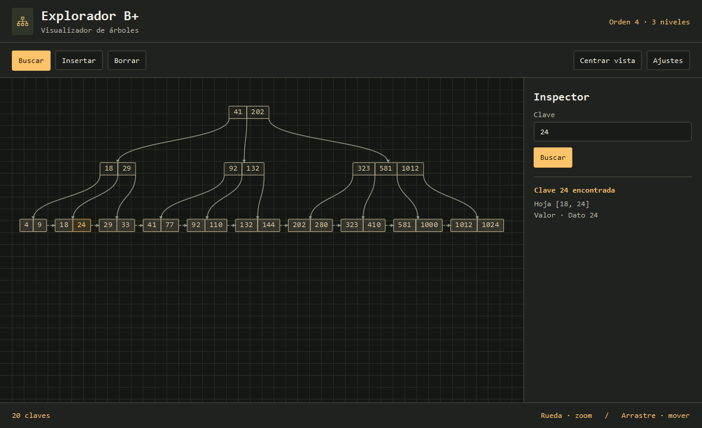
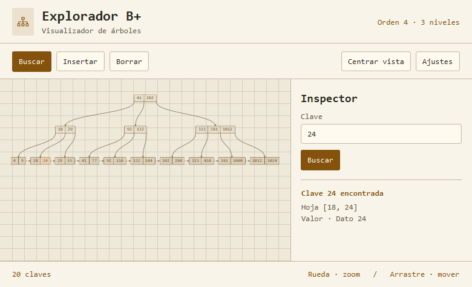

# B+ Tree Visualizer

A JavaFX desktop application for exploring B+ trees. Insert, find, and remove integer keys while the canvas shows search paths, node splits, redistribution, and merges. The inspector displays the value and leaf for a successful search.

**JDK 22+ · JavaFX 22.0.1 · Maven**



## Quick start

Install a **JDK 22 or later** and make sure the terminal uses that JDK. Maven downloads JavaFX and the project dependencies.

```bash
git clone https://github.com/MauricioART/B-Tree-Algorithm.git
cd B-Tree-Algorithm
```

| Environment | Run the application |
| --- | --- |
| Windows PowerShell | `.\mvnw.cmd javafx:run` |
| Linux or macOS | `sh ./mvnw javafx:run` |
| Installed Maven | `mvn javafx:run` |

To compile the project and run Maven’s test phase, use `mvn clean test` or the corresponding wrapper command.

## Explore the tree

| Control | What it does |
| --- | --- |
| **Insertar** | Adds an integer key and its text value. The inspector reports duplicate keys. |
| **Buscar** | Highlights the search path when traversal animation is enabled. A successful search keeps the key highlighted and shows its leaf and value. |
| **Borrar** | Removes the key and animates any redistribution or merge. |
| **Centrar vista** | Restores the default zoom and position. Scroll to zoom and drag to pan. |
| **Ajustes** | Select the tree order (4–10), animation speed (0.5×–1.5×), traversal animation, sound, or the light theme. Changing the order prompts for confirmation when the tree contains keys. |

To see the first split at order 4, insert `4`, `9`, `18`, and `24`. Then search for `24` to follow the route from the root to its leaf.

### Light theme

Enable **Tema claro** in **Ajustes** to use the warm light palette.



## Project structure

| Area | Responsibility |
| --- | --- |
| [Model](src/main/java/com/arturoar/model) | B+ tree operations, linked leaves, and structural events. |
| [Controller](src/main/java/com/arturoar/controller/BPlusTreeController.java) | Inspector, settings, and operation lifecycle. |
| [View](src/main/java/com/arturoar/view) | Node and edge rendering, layout, and traversal highlights. |
| [Animation queue](src/main/java/com/arturoar/util/TreeAnimator.java) | Playback of traversal and structural transitions. |
| [FXML and CSS](src/main/resources/com/arturoar/ui) | Interface layout, theme, and packaged resources. |

### Animation performance

The view batches resize layout, skips movement animations for stationary elements, and binds arrowhead positions to their endpoints. In a JavaFX comparison with 40 ascending inserts, traversal enabled, order 4, and an 880 × 540 canvas, the queue contained **2,158 animation objects**, down from **4,716** at commit `d926419` (54% fewer). The count includes nested animations scheduled before playback.

## License and credits

The project uses the [MIT License](LICENSE). Sound effects are from [Pixabay](https://pixabay.com/).

- Pop and whoosh by **DRAGON-STUDIO**
- Success by **u_3bsnvt0dsu**
- Error by **Universfield**
